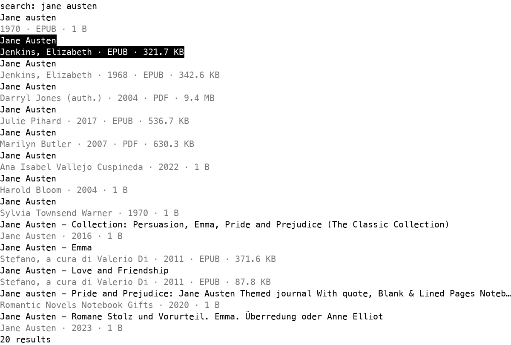
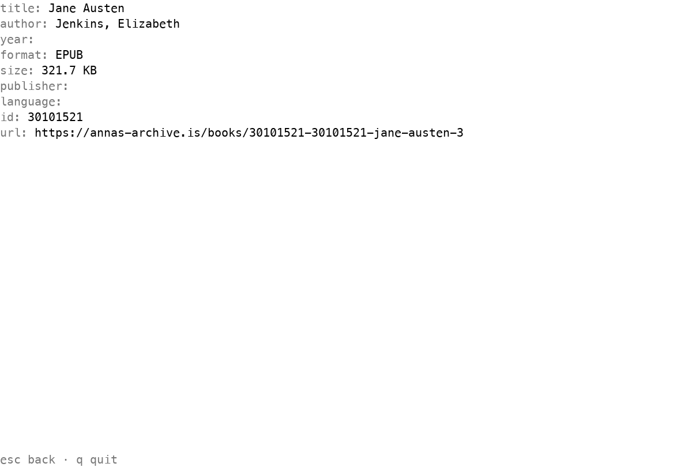

# booxd

Search, inspect, and download books from Anna’s Archive with a terminal app built for Boox and Termux.



booxd provides search, book details, gated downloads, and an interactive TUI. The `search`, `show`, `get`, and `tui` commands can also use a Z-Library EAPI host that you configure; see [Z-Library](#z-library). `search --source irc` adds an experimental IRC channel search. It runs in the foreground; `serve` is not implemented. On Android, `get --open` hands a saved file to `termux-open` and Android’s default file handler.

## Installation

| Platform | Architecture | Installer |
| --- | --- | --- |
| Boox / Android (Termux) | arm64 | `install.sh` |
| macOS | arm64, amd64 | `install.sh` |
| Linux | arm64, amd64 | `install.sh` |
| Windows | amd64 | `install.ps1` |

Install on Termux, macOS, or Linux:

```sh
curl -fsSL https://github.com/curedbylethe/booxd/releases/latest/download/install.sh | sh
```

Install on Windows PowerShell:

```powershell
irm https://github.com/curedbylethe/booxd/releases/latest/download/install.ps1 | iex
```

Verify installation:

```sh
booxd version
```

Run the same command in PowerShell.

If the installer updates `PATH`, open a new terminal when it says to.

booxd checks for a newer release at most once a day at startup, and only when stdin and stderr are terminals. Answering `y` downloads the archive for the running platform, verifies its checksum, replaces the binary, and restarts booxd with the same arguments. Any other answer continues with the requested command. Set `BOOXD_NO_UPDATE_CHECK` or `no_update_check = true` to disable the check. On Windows, booxd prints the `install.ps1` command instead of replacing itself.

Uninstall on Termux:

```sh
rm -f "$PREFIX/bin/booxd"
```

Uninstall on macOS or Linux:

```sh
rm -f "$HOME/.local/bin/booxd"
```

Uninstall on Windows:

```powershell
Remove-Item "$env:LOCALAPPDATA\Programs\booxd" -Recurse -Force
```

Then remove `%LOCALAPPDATA%\Programs\booxd` from your user `PATH` in Edit environment variables.

See [Termux setup](docs/termux.md) for Boox details. See [CONTRIBUTING.md](CONTRIBUTING.md) to build from source.

## Quick start

1. Install booxd with the command above.
2. Optionally create a TOML config; see [Configuration](#configuration).
3. Launch the TUI:

   ```sh
   booxd tui
   ```

   Run the same command in PowerShell.

4. Type a title or author, then press `Enter`. Move with `j`/`k`; press `Enter` to view a book and read its description. Press `Tab` to switch the source between `anna` and `zlibrary`; on a Z-Library book, press `d` to download it.
5. Or use the CLI:

   ```sh
   booxd search "jane austen"
   booxd show BOOK_ID
   booxd get --cookies cookies.txt --open BOOK_ID
   ```

`get` needs a Netscape cookie file from a signed-in session; booxd never obtains one. `--open` works on Termux / Android only. An interrupted download resumes only when the server identified the file with a strong `ETag` or `Last-Modified` header and the retry reaches the same host and path; otherwise it restarts.



*Book details shown in the TUI.*

## Controls

| Key | Action | Context |
| --- | --- | --- |
| `Ctrl-C` | Quit | Anywhere |
| `?` | Toggle help | Results or details; `?` or `Esc` closes help |
| `Enter` | Search or open selected book | Query or results |
| `Tab` | Switch source: `anna`, then `zlibrary`, then `anna`; on results, search the query again | Query or results |
| `d` | Download the book | Details of a Z-Library book |
| `Esc` | Go back; on a book that is downloading, cancel the download first | Query, results, details |
| `Backspace`, `Delete` | Edit query | Query |
| `Left`, `Right`, `Home`, `End` | Move caret | Query |
| `Up`, `Down`, `j`, `k` | Move selection | Results |
| `n`, `p` | Next page, previous page of results; `p` does nothing on page 1 | Results |
| `Up`, `Down`, `j`, `k` | Scroll the description | Details |
| `/` | Edit query | Results or details |
| `q` | Quit | Results or details |

The search line names the selected source, for example `search [zlibrary]: dune`. The TUI starts on `anna`, or on the `tui --source` value; a change made with `Tab` lasts until you quit and is not saved to config.

The results footer reads `N results · page P`. `n` and `p` request the next and previous page; the new page replaces the rows and selects the first one. A page with no results, or one that fails, leaves the previous rows and page on screen and changes only the footer. A new search, or `Tab`, returns to page 1. Page numbers are relative: booxd does not know how many pages exist.

The details screen has a `download:` row. It shows `-` before a download, `…` while it starts, then the percentage in whole steps on a known size, or whole MiB when the server does not report one. When the download ends, it shows `saved <path>`, `already downloaded`, `session expired`, `quota exhausted`, `cancelled`, or `failed`. While a download runs, the footer reads `esc cancel`; the first `Esc` cancels it and keeps the details on screen, and a second `Esc` goes back. A missing Z-Library setting shows `failed:` and the same message as the CLI. On an Anna's Archive book, the row shows `zlibrary only` and `d` does nothing. Searches and downloads run in the background, so keys keep working; when you search again, the result of an older search is discarded.

## CLI reference

Flags go before the search query or book ID. `tui` reads config from `BOOXD_CONFIG`; it has no `--config`, `--mirror`, or `--verbose` flags.

| Command | Arguments and flags | Purpose |
| --- | --- | --- |
| `booxd search` | `--config`, `--source` (anna, zlibrary, or experimental irc), `--mirror`, `--page` (1), `--dump-html`, `--max-age` (24h), `--no-cache`, `--verbose`, `--language`, `--format` (both Z-Library only, repeatable); query | Search the catalog. `--mirror` skips discovery; `--dump-html` writes raw or cached HTML. `--language` and `--format` filter results on the Z-Library host. `--source irc` searches the configured IRC channel; anna-only and Z-Library-only flags are rejected. |
| `booxd show` | `--config`, `--source` (anna, zlibrary or experimental irc), `--mirror` (anna only), `--verbose`; one book ID | Show metadata and download options; an `irc:` reference is read offline. |
| `booxd get` | `--config`, `--source` (anna, zlibrary or experimental irc), `--cookies` and `--mirror` (anna only), `--open`, `--verbose`; one book ID | Download with a supplied Netscape cookie jar, a Z-Library session, or over DCC for an `irc:` reference. `--open` invokes `termux-open` on Android. |
| `booxd tui` | `--source` (anna), `--mono` | Open interactive search. `--source` sets the first source; `--mono` selects monochrome theme. |
| `booxd version`, `booxd --version` | None | Print version and target. |
| `booxd serve` | None | Not implemented; exits 1. |

```sh
booxd search --page 2 "jane austen"
booxd search --source zlibrary --language en --format epub "dune"
booxd show BOOK_ID
booxd get --cookies cookies.txt BOOK_ID
```

`--source` accepts `anna`, `zlibrary`, and `irc`; `anna` is the default. IRC search is experimental: it joins the `[irc] channel` on `[irc] server`, prints one `irc: searching <channel> (experimental source)` line, then prints results. The first column is a source-qualified reference such as `irc:%21artemis_serv%2016d6770d2ba9%20%7C%20The%20Last%20Hero.pdf`; it carries the request needed to reproduce the offer and round-trips through `source.Parse` and `BookFromRef`. An empty result set is not an error. A dial, send, timeout, or malformed-archive failure exits with status 1 and prints `booxd: <error>`; cancellation is reported the same way. Any other `--source` value exits with status 2 and `booxd: unknown source "<value>"`.

`BOOK_ID` is the ID that `search` prints. For Anna's Archive it is `36451`, the same ID with a slug (`36451-the-hobbit`), or the qualified form `anna:36451`. For Z-Library it is `zlibrary:36451/<hash>`, or `36451/<hash>` with `--source zlibrary`. For IRC it is the escaped request line printed by search, for example `'irc:%21artemis_serv%2016d6770d2ba9%20%7C%20The%20Last%20Hero.pdf'`; quote it so the shell keeps the `!` and the spaces. That printed form is the only accepted IRC reference: a bare pack ID or an unescaped request line exits with status 2 and `booxd: source irc: ...`. A source prefix in `BOOK_ID` wins over `--source`.

`--mirror`, `--cookies`, `--dump-html`, and `--max-age` apply to Anna's Archive only. With Z-Library or IRC they exit with status 2 and `booxd: --<flag> applies to anna only`. `--page` applies to Anna's Archive and Z-Library; with IRC, a value other than `1` exits with status 2 and `booxd: --page applies to anna and zlibrary only`. With Z-Library, `--no-cache` skips both reading and writing the cache. IRC never caches results, so `--no-cache` is accepted and ignored.

`--language` and `--format` apply to Z-Library only. With `anna` or `irc` they exit with status 2 and `booxd: --<flag> applies to zlibrary only`. Each flag takes one value per use and can be repeated; a comma list is not accepted. The Z-Library host does the filtering, so results match its EAPI behaviour; booxd does not re-filter. A TUI selector may follow; for now the flags are CLI-only.

`--language` accepts an ISO 639-1 code or the EAPI name it maps to: `en`, `fa`, `fr`, `de`, `es`, `it`, `pt`, `ru`, `zh`, `ja`, `ko`, `ar`, `hi`, `bn`, `tr`, `pl`, `nl`, `sv`, `no`, `da`, `fi`, `cs`, `el`, `he`, `hu`, `id`, `ro`, `sk`, `uk`, `vi`, `th`, `bg`, `sr`, `hr`, `sl`, `et`, `lv`, `lt`, `ca`, `ms`, `ur`, `sw`, `ta`, `te`, `ml`, `kn`, `gu`, `pa`, `ne`, `si`, `km`, `lo`, `my`, `ka`, `hy`, `az`, `kk`, `uz`, `be`, `mk`, `sq`, `bs`, `is`, `ga`, `cy`, `mt`, `lb`, `af`, `am`, `yo`, `ig`, `ha`, `zu`, `xh`, `so`, `ps`, `ku`, `tg`, `ky`, `mn`, `bo`, `dz`, `ug`. The matching EAPI name (for example `english` for `en`, `persian` for `fa`) is also accepted. An unknown value exits with status 2 and `booxd: unknown language "<value>"`. `--format` accepts `AZW`, `AZW3`, `CBZ`, `DJV`, `DJVU`, `EPUB`, `FB2`, `LIT`, `MOBI`, `PDF`, `RTF`, `TXT`, case-insensitively. An unknown value exits with status 2 and `booxd: unknown format "<value>"`.

| Exit code | Meaning |
| --- | --- |
| `0` | Success or no search results |
| `1` | Runtime failure |
| `2` | Usage error, unknown or unavailable source, missing download session, or missing Z-Library `base_url` or session file |

## Configuration

Config loads from `booxd/config.toml` under the OS config directory. Flags override environment variables, which override the file and compiled defaults. Paths must be absolute; `~` and `$HOME` are not expanded. The startup update check runs before flags are parsed, so it reads the default config file and `BOOXD_CONFIG` only; a file selected with `--config` does not affect it.

| Option | Default | Description |
| --- | --- | --- |
| `mirrors` | Embedded seeds | Preferred absolute `http`/`https` base URLs, without userinfo. |
| `download_dir` | `$HOME/Downloads` | Download destination. |
| `cache_dir` | OS user cache directory | Cache root; booxd stores data in its `booxd` subdirectory. |
| `proxy` | Empty | `http`, `https`, or `socks5` proxy URL. |
| `user_agent` | `booxd/0.1` | HTTP User-Agent. |
| `request_timeout` | `30s` | Positive Go duration for requests. |
| `per_host_interval` | `1s` | Minimum time between request starts to one host. |
| `no_update_check` | `false` | Disable the startup update check. |
| `[zlibrary] base_url` | Empty | Absolute `https` URL of the Z-Library EAPI host. Required for `--source zlibrary`. |
| `[zlibrary] session_file` | Empty | Netscape cookie file with the `remix_userid` or `remix_userkey` cookie for `base_url`. Required for `get` and TUI downloads; optional for `search`, `show`, and TUI search. |
| `[irc] server` | `irc.irchighway.net:6697` | IRC `host:port` server for channel search and downloads. |
| `[irc] nick` | `booxd` | IRC nickname. |
| `[irc] channel` | `#ebooks` | IRC channel to join; must start with `#`. |
| `[irc] search_timeout` | `2m` | Positive Go duration to wait for an IRC bot reply. |
| `[irc] download_timeout` | `30m` | Positive Go duration to wait for an IRC download. |

Environment: `BOOXD_CONFIG`, `BOOXD_MIRRORS`, `BOOXD_DOWNLOAD_DIR`, `BOOXD_CACHE_DIR`, `BOOXD_PROXY`, `BOOXD_USER_AGENT`, `BOOXD_REQUEST_TIMEOUT`, `BOOXD_PER_HOST_INTERVAL`, `BOOXD_NO_UPDATE_CHECK`, `BOOXD_ZLIBRARY_BASE_URL`, `BOOXD_ZLIBRARY_SESSION_FILE`, `BOOXD_IRC_SERVER`, `BOOXD_IRC_NICK`, `BOOXD_IRC_CHANNEL`, `BOOXD_IRC_SEARCH_TIMEOUT`, `BOOXD_IRC_DOWNLOAD_TIMEOUT`.

| Platform | Config file | Cache |
| --- | --- | --- |
| macOS | `$HOME/Library/Application Support/booxd/config.toml` | `$HOME/Library/Caches/booxd/cache` |
| Linux / Termux | `$XDG_CONFIG_HOME/booxd/config.toml` or `$HOME/.config/booxd/config.toml` | `$XDG_CACHE_HOME/booxd/cache` or `$HOME/.cache/booxd/cache` |
| Windows | `%AppData%\booxd\config.toml` | `%LocalAppData%\booxd\cache` |

Example:

```toml
download_dir = "/home/you/Downloads"
request_timeout = "45s"
per_host_interval = "2s"
```

### Z-Library

booxd has no built-in Z-Library host. Set `base_url` to the EAPI host you use:

```toml
[zlibrary]
base_url = "https://eapi.example.invalid"
session_file = "/home/you/zlibrary-cookies.txt"
```

Export the session file from a browser where you are signed in. booxd never signs in, asks for a password, or refreshes a session. Without `session_file`, `search` and `show` work anonymously and use the cache. With `session_file`, booxd sends its cookies only to the host they belong to and does not cache responses. booxd never prints cookie values or download links.

## IRC (experimental)

IRC is opt-in and experimental. Pass `--source irc` to `search`, or pass a printed `irc:` reference to `show` or `get`. No account, cookie or session is used: booxd sends no credentials and never tries to obtain them. The `[irc]` keys are `server`, `nick`, `channel`, `search_timeout` and `download_timeout` (see the configuration table and the `BOOXD_IRC_*` variables).

Each IRC command prints one static status line and no spinner, progress updates or cursor movement: `irc: searching <channel> (experimental source)` for `search`, and `irc: requesting <name>.<format> from <server>` for `get`. `show` is offline, prints no status line, and reads the title, format and source from the reference alone.

`get` streams the bot's offer over DCC into `download_dir`. DCC bypasses the HTTP cache, proxy, cookie jar and `internal/fetch`. The transfer writes `<name>.<format>.part` and renames it only when the received byte count matches the offer. A failed or interrupted transfer exits 1 and leaves the `.part`; the next `get` truncates it and starts over. There is no resume. A non-empty final file is reported as `already downloaded`, with no request sent.

A reference stays usable as long as the bot still answers that pack's request. Nothing expires locally and booxd keeps no reference database. When the bot or pack is gone, `get` fails with `booxd: source irc: ...` or `booxd: irc: ...`; search again for a fresh reference. A stale reference cannot fetch the wrong file: the request line names the bot, the pack and the file, and the transfer is validated against the offer's own byte count.

Availability is not guaranteed. booxd indexes nothing: it listens in a public IRC channel whose bots, packs and files appear and vanish. Downloads are checked only against the bytes the bot offers, not against a catalogue, checksum or signature; speed and completeness depend on the channel and the bot. Access to the channel and its files may be limited by local law, network policy or channel rules. You are responsible for complying with those rules and with the law where you are. Network access to the configured IRC server and a reachable DCC connection are required.

## Troubleshooting

| Symptom | Solution |
| --- | --- |
| Termux cannot save downloads | Run `termux-setup-storage` and grant permission. Set the download directory with the command below. Keep booxd in `$PREFIX/bin`; shared storage such as `/sdcard` is `noexec`. |
| `termux-open` is missing | Run `pkg install termux-tools`. |
| Android DNS errors | Check `$PREFIX/etc/resolv.conf` for a reachable nameserver; booxd falls back to `8.8.8.8`. |
| HTTP 429 or slow requests | Wait; booxd respects 429 and allows one in-flight request per host. Use cache; `--no-cache` bypasses it. |
| Cookie / mirror mismatch | Use a cookie file for the same site as the mirror. `get` skips cache. |
| Config error | Check TOML keys, positive durations, absolute mirror URLs, and the selected `BOOXD_CONFIG` file. |
| TUI needs 80x24 | Enlarge the terminal to at least 80 columns by 24 rows. |
| Search says `no results` | Empty results exit successfully with code 0. |
| `zlibrary needs [zlibrary] base_url` | Set `base_url` in `[zlibrary]` or `BOOXD_ZLIBRARY_BASE_URL`. |
| `base_url ... must be an https URL` | Use an absolute `https://` URL. |
| `read cookie file ...` | Check that `session_file` names a readable Netscape cookie file. |
| `session file ... has no remix_userid or remix_userkey cookie` | Export the cookies again from a signed-in session on the `base_url` host. |
| `downloads need a signed-in session; set [zlibrary] session_file` | Set `session_file`; Z-Library downloads need a session. |
| `session rejected: ...; supply a fresh session file` | The session expired or was signed out. Export a new cookie file. |
| `download quota exhausted: ...` | The account reached its download limit. Wait for the limit to reset; booxd does not retry. |
| `host is challenging automated requests` | The host shows a browser check. booxd does not retry; try later or choose another host. |
| `zlibrary: host did not answer: <host>` | The Z-Library host timed out or refused the connection. Check the network and `base_url`, then try again. In the TUI, the message shows on the status line. |
| `zlibrary: download link expired or refused (status N); run get again` | The host rejected the download link with status 401, 403, 404, or 410. Run `get` again for a fresh link. In the TUI, the download row shows `failed`; press `d` again. |
| `down: server sent a web page or an empty body, not a book` | The server answered with a web page, such as a sign-in page, or with nothing. booxd saves no file. Check the session or cookie file, then try again. |
| `irc: searching #... (experimental source)` | Informational: IRC search is experimental. Wait for the bot's reply; one line is printed per invocation, with no spinner or progress updates. |
| `booxd: irc: ...` or `booxd: source irc: ...` | Check `[irc] server`, `nick`, `channel`, and `search_timeout` (or their `BOOXD_IRC_*` variables), plus network access. A missing search bot or a malformed archive surfaces here; booxd does not retry. |
| `no offer from "<nick>" within <duration>` | The requested bot did not answer before `[irc] search_timeout` (or `download_timeout` for `get`). Search again; bots and packs come and go. |
| `wrote N of M bytes; partial kept at ...` | The transfer did not match the bot's offered byte count. The `.part` file is kept; run `get` again to restart from scratch. |
| `booxd: context canceled` or `booxd: context deadline exceeded` | The transfer was interrupted with Ctrl-C or hit `[irc] download_timeout`. The `.part` file is kept; run `get` again to restart. |
| `booxd: source irc: reference ... is not a request line` | The `irc:` reference is malformed. Copy the full escaped reference from `search` and quote it on the command line; a bare pack ID is not accepted. |
| `booxd: --page applies to anna and zlibrary only` | Omit `--page` when you use `--source irc`; IRC has no result pages. |
| `booxd: --mirror applies to anna only` | Remove Anna-only flags when you use `--source zlibrary` or `--source irc`, or a `zlibrary:` ID. |

```sh
export BOOXD_DOWNLOAD_DIR="$HOME/storage/downloads"
```

## Documentation

- [E-ink redraw rules](docs/eink.md)
- [Termux / Boox setup](docs/termux.md)
- [Contributor guide](CONTRIBUTING.md)
- [Repository rules](AGENTS.md)
- [Project conventions](https://linear.app/curedbylethe/document/booxd-project-conventions-bf3f21ac3632)
