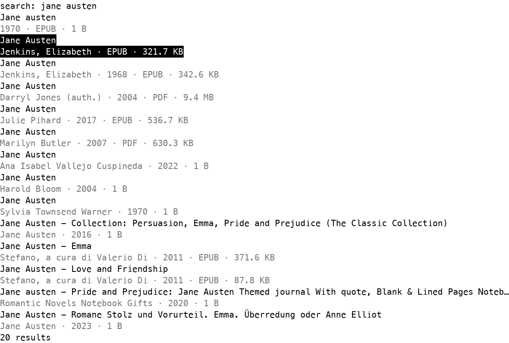
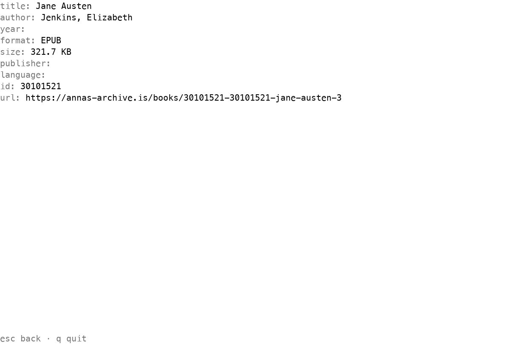

# booxd

Search, inspect, and download books from Anna’s Archive with a terminal app built for Boox and Termux.



booxd provides search, book details, gated downloads, and an interactive TUI. It runs in the foreground; `serve` is not implemented. On Android, `get --open` hands a saved file to `termux-open` and Android’s default file handler.

## Installation

| Platform | Architecture | Installer |
| --- | --- | --- |
| Boox / Android (Termux) | arm64 | `install.sh` |
| macOS | arm64, amd64 | `install.sh` |
| Linux | arm64, amd64 | `install.sh` |
| Windows | amd64 | `install.ps1` |

Install on Termux, macOS, or Linux:

```sh
curl -fsSL https://github.com/curedbylethe/booxd/releases/latest/download/install.sh | sh
```

Install on Windows PowerShell:

```powershell
irm https://github.com/curedbylethe/booxd/releases/latest/download/install.ps1 | iex
```

Verify installation:

```sh
booxd version
```

```powershell
booxd version
```

If the installer updates `PATH`, open a new terminal when it says to. Upgrade by running your installer again.

Uninstall on Termux:

```sh
rm -f "$PREFIX/bin/booxd"
```

Uninstall on macOS or Linux:

```sh
rm -f "$HOME/.local/bin/booxd"
```

Uninstall on Windows:

```powershell
Remove-Item "$env:LOCALAPPDATA\Programs\booxd" -Recurse -Force
```

See [Termux setup](docs/termux.md) for Boox details. See [CONTRIBUTING.md](CONTRIBUTING.md) to build from source.

## Quick start

1. Install booxd with the command above.
2. Optionally create a TOML config; see [Configuration](#configuration).
3. Launch the TUI:

   ```sh
   booxd tui
   ```

   PowerShell:

   ```powershell
   booxd tui
   ```

4. Type a title or author, then press `Enter`. Move with `j`/`k`; press `Enter` to view a book.
5. Or use the CLI:

   ```sh
   booxd search "jane austen"
   booxd show BOOK_ID
   booxd get --cookies cookies.txt --open BOOK_ID
   ```

`get` needs a Netscape cookie file from a signed-in session; booxd never obtains one. `--open` works on Termux / Android only.



*Book details shown in the TUI.*

## Controls

| Key | Action | Context |
| --- | --- | --- |
| `Ctrl-C` | Quit | Anywhere |
| `?` | Toggle help | Results or details; `?` or `Esc` closes help |
| `Enter` | Search or open selected book | Query or results |
| `Esc` | Go back | Query, results, details |
| `Backspace`, `Delete` | Edit query | Query |
| `Left`, `Right`, `Home`, `End` | Move caret | Query |
| `Up`, `Down`, `j`, `k` | Move selection | Results |
| `/` | Edit query | Results or details |
| `q` | Quit | Results or details |

## CLI reference

Flags go before the search query. `tui` reads config from `BOOXD_CONFIG`; it has no `--config`, `--mirror`, or `--verbose` flags.

| Command | Arguments and flags | Purpose |
| --- | --- | --- |
| `booxd search` | `--config`, `--mirror`, `--page` (1), `--dump-html`, `--max-age` (24h), `--no-cache`, `--verbose`; query | Search the catalog. `--mirror` skips discovery; `--dump-html` writes raw or cached HTML. |
| `booxd show` | `--config`, `--mirror`, `--verbose`; one book ID | Show metadata and download options. |
| `booxd get` | `--config`, `--cookies`, `--mirror`, `--open`, `--verbose`; one book ID | Download with a supplied Netscape cookie jar. `--open` invokes `termux-open` on Android. |
| `booxd tui` | `--mono` | Open interactive search; `--mono` selects monochrome theme. |
| `booxd version`, `booxd --version` | None | Print version and target. |
| `booxd serve` | None | Not implemented; exits 1. |

```sh
booxd search --page 2 "jane austen"
booxd show BOOK_ID
booxd get --cookies cookies.txt BOOK_ID
```

| Exit code | Meaning |
| --- | --- |
| `0` | Success or no search results |
| `1` | Runtime failure |
| `2` | Usage error or missing download session |

## Configuration

Config loads from `booxd/config.toml` under the OS config directory. Flags override environment variables, which override the file and compiled defaults. Paths must be absolute; `~` and `$HOME` are not expanded.

| Option | Default | Description |
| --- | --- | --- |
| `mirrors` | Embedded seeds | Preferred absolute `http`/`https` base URLs, without userinfo. |
| `download_dir` | `$HOME/Downloads` | Download destination. |
| `cache_dir` | OS user cache directory | Cache root; booxd stores data in its `booxd` subdirectory. |
| `proxy` | Empty | `http`, `https`, or `socks5` proxy URL. |
| `user_agent` | `booxd/0.1` | HTTP User-Agent. |
| `request_timeout` | `30s` | Positive Go duration for requests. |
| `per_host_interval` | `1s` | Minimum time between request starts to one host. |

Environment: `BOOXD_CONFIG`, `BOOXD_MIRRORS`, `BOOXD_DOWNLOAD_DIR`, `BOOXD_CACHE_DIR`, `BOOXD_PROXY`, `BOOXD_USER_AGENT`, `BOOXD_REQUEST_TIMEOUT`, `BOOXD_PER_HOST_INTERVAL`.

| Platform | Config file | Cache |
| --- | --- | --- |
| macOS | `$HOME/Library/Application Support/booxd/config.toml` | `$HOME/Library/Caches/booxd/cache` |
| Linux / Termux | `$XDG_CONFIG_HOME/booxd/config.toml` or `$HOME/.config/booxd/config.toml` | `$XDG_CACHE_HOME/booxd/cache` or `$HOME/.cache/booxd/cache` |
| Windows | `%AppData%\booxd\config.toml` | `%LocalAppData%\booxd\cache` |

Example:

```toml
download_dir = "/home/you/Downloads"
request_timeout = "45s"
per_host_interval = "2s"
```

## Troubleshooting

| Symptom | Solution |
| --- | --- |
| Termux cannot save downloads | Run `termux-setup-storage` and grant permission; set `download_dir` to `$HOME/storage/downloads`. Keep booxd in `$PREFIX/bin`; shared storage such as `/sdcard` is `noexec`. |
| `termux-open` is missing | Run `pkg install termux-tools`. |
| Android DNS errors | Check `$PREFIX/etc/resolv.conf` for a reachable nameserver; booxd falls back to `8.8.8.8`. |
| HTTP 429 or slow requests | Wait; booxd respects 429 and allows one in-flight request per host. Use cache; `--no-cache` bypasses it. |
| Cookie / mirror mismatch | Use a cookie file for the same site as the mirror. `get` skips cache. |
| Config error | Check TOML keys, positive durations, absolute mirror URLs, and the selected `BOOXD_CONFIG` file. |
| TUI needs 80x24 | Enlarge the terminal to at least 80 columns by 24 rows. |
| Search says `no results` | Empty results exit successfully with code 0. |

## Documentation

- [E-ink redraw rules](docs/eink.md)
- [Termux / Boox setup](docs/termux.md)
- [Contributor guide](CONTRIBUTING.md)
- [Repository rules](AGENTS.md)
- [Project conventions](https://linear.app/curedbylethe/document/booxd-project-conventions-bf3f21ac3632)
